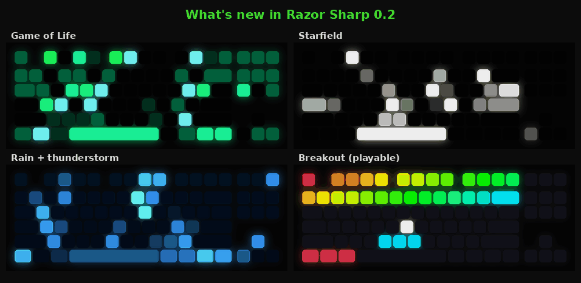

# Changelog

## 0.2.0 — 2026-11-18

**New: Settings window** (⚙ in the header), with these features that apply to every effect, including your own:

- **Key highlights**: fixed-colour keys on top of any effect, from presets (WASD, arrows, F-keys and more) or your own list. Shown in the preview too.
- **Status keys**: Caps/Num/Scroll Lock glow while on, Esc pulses red on low battery, and an optional mic-muted key.
- **Night mode**: dims everything between two times.
- **Lights off when idle**: after a set number of minutes without keyboard or mouse input (GNOME, or `xprintidle` on X11).
- **App profiles**: switch effects automatically while chosen apps run, and switch back when they close. Works with the window closed, and starts at login.
- **Keyboard shortcuts**: one click adds next/previous/on-off shortcuts to GNOME.
- **Backup**: export and import all settings, presets, layouts and your own effects as one file.
- **Frame rate** setting for lower CPU and battery use.

**New effects:** Game of Life, Starfield, Rain (with thunderstorm), WPM Meter, and Breakout, a second playable game.

**Arch Linux package:** a `.pkg.tar.zst` is now attached to each release, built from `packaging/aur/PKGBUILD`.

**Command line:** `--effect NAME`, `--next`, `--previous`, `--toggle` and `--help`.

**For effect authors:** `fx.key_events(repeats=True)` includes key auto-repeat, which helps games. Highlights, status keys, night mode, idle-off and frame rate apply to every effect automatically.

## 0.1.0 — 2026-11-18

First public release.

- 19 effects. **Reactive:** Shockwave, Reverse Ripple, Reactive Fade, Lightning, Fireworks, Comet Trail, Combo Meter, Typing Heatmap. **Ambient:** Palette, Fire, Matrix Rain, Plasma, Twinkle, Ocean Waves. **Tools:** Audio Visualizer, System Monitor, Pomodoro, Notification Flash. **Games:** Snake.
- Lighting modes: solid, gradient, rainbow, spectrum and breathing, with 9 presets and your own saved presets.
- Separate brightness for the lighting and for the effect.
- Live keyboard preview, drawn for the detected keyboard.
- Effects run in the background, keep going after the window is closed, and can start at login.
- Effects pause and go dark while the screen is locked or blanked.
- Key-mapping tool for any OpenRazer keyboard with per-key lighting; built-in layouts for tenkeyless (verified) and full-size keyboards.
- Write your own effects in Python, with options shown in the app automatically.
- Moves settings over from the pre-release "Razer Effects" app.
