<p align="center">
  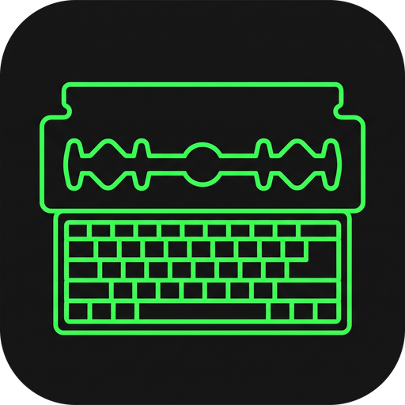
</p>

<h1 align="center">Razor Sharp</h1>

<p align="center">
  <b>Typing-reactive lighting effects for Razer keyboards on Linux.</b><br>
  Built on <a href="https://openrazer.github.io/">OpenRazer</a>. 24 effects, two games, smart automations, and effects you can write yourself in a few lines of Python.
</p>

<p align="center">
  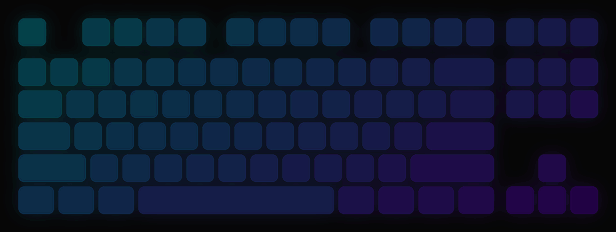
</p>

<p align="center">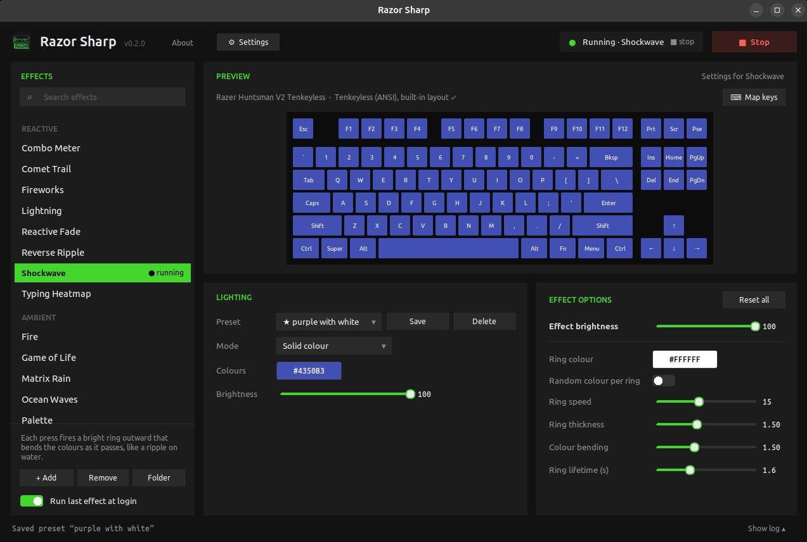</p>

## Features

- **24 effects**: ripples, lightning, fireworks, fire, rain, a starfield, Conway's Game of Life, a typing heatmap, a WPM meter, an audio visualiser, a system monitor, a Pomodoro timer, notification flashes, and two playable games: **Snake** and **Breakout**.
- **Lighting controls**: solid, gradient, rainbow, spectrum and breathing modes, nine presets plus your own, with a live keyboard preview.
- **Two brightness levels**: dim the background while the effect itself stays bright, or the other way round.
- **Runs in the background**: close the window and the effect keeps going. It can also start at login without opening a window.
- **Any keyboard**: a built-in *Map keys* tool learns your keyboard's layout in a couple of minutes.
- **Key highlights**: keep WASD, the arrows or any keys you choose in a fixed colour on top of every effect.
- **Status keys**: Caps/Num/Scroll Lock glow while on, Esc pulses on low battery, and a key of your choice turns red while your mic is muted.
- **App profiles**: switch effects automatically while an app runs (Fire while Steam is open, Pomodoro while VS Code is open) and switch back after.
- **Night mode and auto-off**: dim everything at night, and switch the lights off when you step away.
- **Keyboard shortcuts**: next/previous effect and on/off, added to GNOME with one click.
- **Backup**: export all your settings to one file and import them anywhere.
- **Plays nicely**: pauses and goes dark while your screen is locked or blanked.
- **Make your own**: an effect is a short Python script. Drop it in and its options appear in the app automatically.

## Effects

| | |
|:---:|:---:|
| 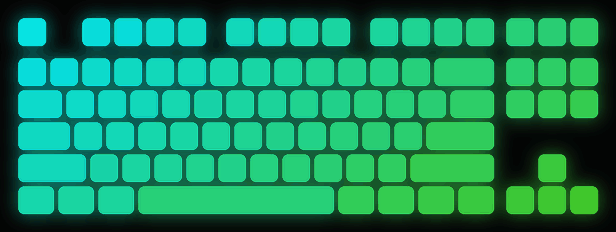<br>**Reverse Ripple** | 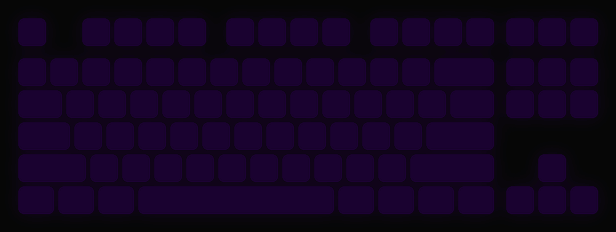<br>**Lightning** |
| 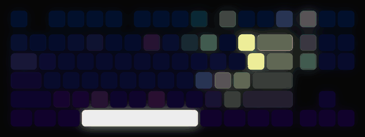<br>**Fireworks** | 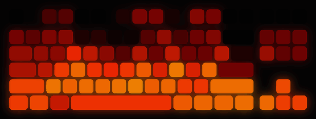<br>**Fire** |
| 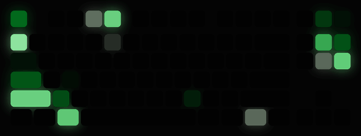<br>**Matrix Rain** | 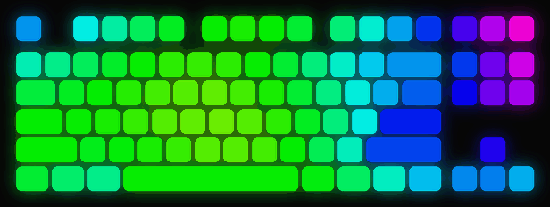<br>**Plasma** |
| <br>**Typing Heatmap** | 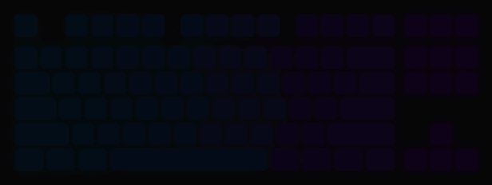<br>**Comet Trail** |
| 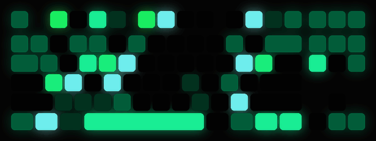<br>**Game of Life** | 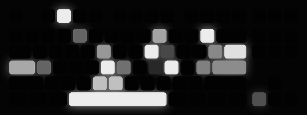<br>**Starfield** |
| 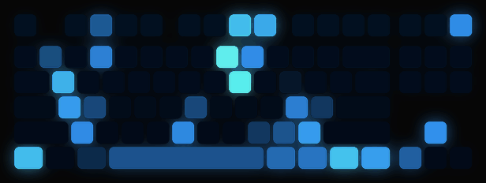<br>**Rain** (thunderstorm) | 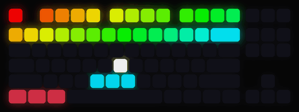<br>**Breakout** (playable) |

<details>
<summary><b>All 24 effects</b></summary>

| Effect | Type | What it does |
|---|---|---|
| Combo Meter | Reactive | The faster you type, the hotter and more intense the keyboard gets; pause and it cools down. |
| Comet Trail | Reactive | The keys you type are joined by a glowing streak that fades from the tail. |
| Fireworks | Reactive | Presses launch rockets that climb the keyboard and burst into coloured sparks. |
| Lightning | Reactive | Each press shoots a jagged, branching bolt across nearby keys that flickers and fades. |
| Reactive Fade | Reactive | Pressed keys flash a colour and fade back to the lighting colours. |
| Reverse Ripple | Reactive | All keys lit; each press sends out a ring that switches keys off before they fade back. |
| Shockwave | Reactive | Each press fires a bright ring outward that bends the colours as it passes. |
| Typing Heatmap | Reactive | Keys you use most glow hotter (blue, yellow, red, white) and slowly cool down. |
| Fire | Ambient | Flickering flames rise from the bottom row; typing makes them flare up. |
| Matrix Rain | Ambient | Code streams fall down the keyboard with bright heads and fading tails. |
| Ocean Waves | Ambient | Layered waves roll across the keyboard with foam on the crests; typing makes splashes. |
| Palette | Ambient | Just your lighting colours, with no reaction to typing. |
| Plasma | Ambient | Smooth, slowly morphing blobs of colour, like a lava lamp. |
| Twinkle | Ambient | Random keys sparkle softly like stars. |
| Game of Life | Ambient | Conway's cellular automaton on your keys; typing seeds new life. |
| Rain | Ambient | Drops fall and splash across the bottom row, with an optional thunderstorm. |
| Starfield | Ambient | Stars stream out from the centre; typing jumps to warp speed. |
| Audio Visualizer | Tools | An equaliser that bounces to whatever is playing. |
| Notification Flash | Tools | A ripple and flash whenever a desktop notification arrives. |
| Pomodoro | Tools | The F-keys count down focus and break time; the keyboard pulses when it's up. |
| System Monitor | Tools | CPU, RAM and temperature as bars across the letter rows. |
| WPM Meter | Tools | The number row shows your typing speed in words per minute, with your best. |
| Snake | Games | A playable game on your keyboard lights. Steer with the arrow keys or WASD. |
| Breakout | Games | Smash the bricks on the top rows with a paddle on the Shift row (← →). |

</details>

## Install

### 1. Set up OpenRazer

Razor Sharp drives your keyboard through [OpenRazer](https://openrazer.github.io/#download). Install it first and make sure your keyboard shows up, for example in Polychromatic. On Ubuntu:

```bash
sudo add-apt-repository ppa:openrazer/stable
sudo apt install openrazer-meta
sudo gpasswd -a $USER plugdev
```

Then reboot. If Secure Boot is on, you may need to enrol the driver's key during that reboot.

### 2. Install Razor Sharp

**Debian, Ubuntu, Linux Mint, Pop!_OS:** download the `.deb` from the [Releases](../../releases) page and run:

```bash
sudo apt install ./razor-sharp_0.2.0_all.deb
```

**Other distributions:** install Tk for Python, the OpenRazer Python bindings and python-evdev with your package manager, then:

```bash
git clone https://github.com/GassanHirra/razor-sharp.git
cd razor-sharp
./scripts/install.sh
```

### 3. First start

Open **Razor Sharp** from your app menu.

- **Allow key presses.** Typing effects need to see your key presses. If they can't yet, a yellow banner offers an **Allow** button, which adds you to the `input` group. Log out and back in afterwards.
  > **Why this matters:** members of the `input` group can read every keyboard and mouse event. That applies to any program you run, not just Razor Sharp. Razor Sharp only uses key presses to animate the lights and never stores or sends them. If you'd rather not grant this, the ambient effects (Fire, Plasma, Matrix Rain and so on) work without it.
- **Check your layout.** Below the preview, Razor Sharp shows which keyboard it found and which layout it's using. If presses light up the wrong keys, click **Map keys** (see below).

## Using it

- Pick an effect on the left and press **Start**. Double-clicking an effect starts it too.
- **Lighting** sets the background colours and **Brightness**. **Effect options** sets everything the effect draws, including its own **Effect brightness**. Changes apply instantly, even while an effect runs.
- Closing the window leaves the effect running. Reopen the app to change or stop it.
- **Run last effect at login** starts your effect in the background when you sign in.
- **+ Add** loads your own `.py` effects. **Folder** opens where they live.

### Settings

Click **⚙ Settings** in the header for the things that apply to every effect:

| Section | What it does |
|---|---|
| Highlights | Fixed-colour keys on top of every effect. Presets for WASD, arrows, F-keys, the number row, modifiers and copy/paste, or type your own keys. |
| Status keys | Lock keys glow while on, Esc pulses red below a battery level you choose, and a chosen key shows when your mic is muted. |
| Night & idle | Dim to a set brightness between two times, and turn the lights off after a number of minutes with no input. Idle time is read from GNOME, or from `xprintidle` on X11. |
| App profiles | Rules like “when *steam* is running, use *Fire*”. Rules are checked top to bottom, the effect switches back when the app closes, and it keeps working with the window closed. |
| Shortcuts | Adds <kbd>Super</kbd>+<kbd>Alt</kbd>+<kbd>→</kbd>/<kbd>←</kbd> (next/previous effect) and <kbd>Super</kbd>+<kbd>Alt</kbd>+<kbd>↓</kbd> (on/off) to GNOME, and removes them again. |
| Backup | Export or import all your settings, presets, highlights, profiles, key layouts and own effects as one file. |
| Performance | Frame rate (20–60). Lower uses less CPU and battery. |

### From a terminal

```bash
razor-sharp                      # open the app
razor-sharp --effect "fire"      # start an effect by name
razor-sharp --next               # next effect (or --previous)
razor-sharp --toggle             # lights on/off
razor-sharp --stop               # stop the running effect
razor-sharp --run-last           # start the last effect in the background
```

## Keyboards

| Keyboard | Status |
|---|---|
| Razer Huntsman V2 Tenkeyless | ✅ Verified |
| Full-size Razer keyboards (BlackWidow, Ornata, Huntsman…) | ⚠️ Built-in layout, not yet confirmed on real hardware |
| Anything else OpenRazer supports with per-key lighting | 🔧 Use **Map keys** |

**Map keys** lights one position at a time; you press the key that lit up, or click *Nothing lit*. It takes a couple of minutes and saves to `~/.config/razor-sharp/layouts/`.

**Please share your layout.** If you map a keyboard that isn't verified yet, [open an issue](../../issues/new?template=keyboard_layout.yml) with the saved file, so it can be built in for everyone.

## Make your own effects

```python
"""Sparkle: pressed keys flash white and fade."""
from razor_fx import Effect, mix

CATEGORY = "Reactive"
PARAMS = {"fade": {"type": "range", "label": "Fade (s)", "min": 0.1, "max": 3, "default": 0.8, "step": 0.1}}

fx = Effect(PARAMS)
flashes = {}

def frame(now):
    for key in fx.key_presses():
        flashes[key] = now
    for y in range(fx.rows):
        for x in range(fx.cols):
            age = now - flashes.get((y, x), -99)
            k = max(0.0, 1 - age / fx.param("fade"))
            fx.set(y, x, mix(fx.base(y, x, now), fx.glow((255, 255, 255)), k))

fx.run(frame)
```

Save it as `sparkle.py` and add it with **+ Add**. Its *Fade* slider appears in the app automatically. The full guide is in [docs/writing-effects.md](docs/writing-effects.md).

## Troubleshooting

<details>
<summary><b>The keyboard doesn't respond, or Polychromatic says "Finish setting up OpenRazer"</b></summary>

The OpenRazer driver isn't loaded yet. Reboot after installing, make sure you're in the `plugdev` group (`groups | grep plugdev`), and check `lsmod | grep razer`. If loading the module fails with "Key was rejected", Secure Boot is blocking it: enrol the key (MOK) or turn Secure Boot off.
</details>

<details>
<summary><b>Typing effects don't react</b></summary>

Click **Allow** on the yellow banner, then log out and back in. You can check with `groups | grep input`.
</details>

<details>
<summary><b>Keys light up in the wrong place</b></summary>

Use **Map keys** under the preview, then restart the effect.
</details>

<details>
<summary><b>The audio visualiser stays flat</b></summary>

It needs `python3-numpy` and `parec` (`sudo apt install python3-numpy pulseaudio-utils`); this works with PipeWire too. Try raising **Sensitivity**.
</details>

<details>
<summary><b>An effect stops with an error</b></summary>

Click **Show log** at the bottom of the window. The log opens by itself when an effect crashes. Please include it when you open an issue.
</details>

## Uninstall

```bash
sudo apt remove razor-sharp        # .deb install
./scripts/uninstall.sh             # script install (add --all to also remove your settings)
```

Your settings and own effects live in `~/.local/share/razor-sharp` and `~/.config/razor-sharp`.

## Contributing

Bug reports, keyboard layouts and new effects are very welcome. See [CONTRIBUTING.md](CONTRIBUTING.md).

## License

[GPL-3.0-or-later](LICENSE).

Razor Sharp is an independent project. It is not affiliated with, endorsed by or sponsored by Razer Inc. "Razer" is a trademark of Razer Inc., used here only to describe which keyboards the app works with.
